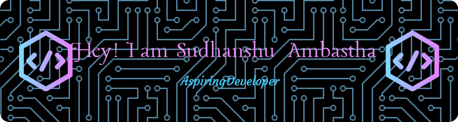
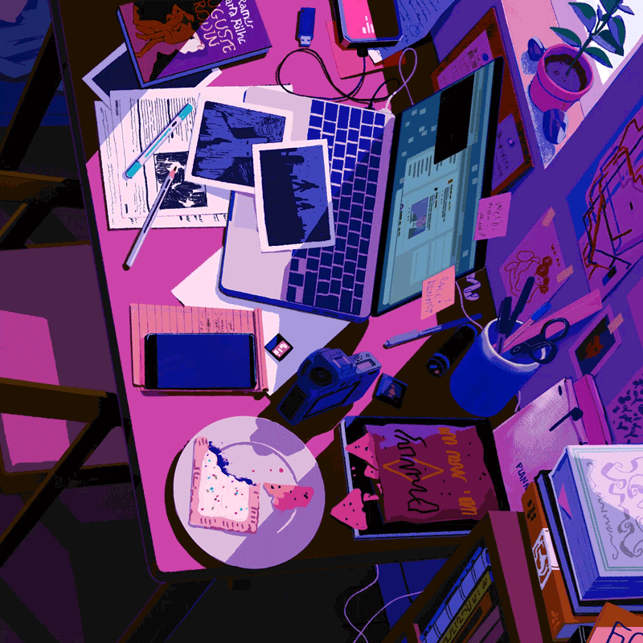

<picture></picture>

Passionate developer focused on creative problem-solving, efficient tooling, and system architecture and writing clean, scalable code.

### <picture></picture> _Languages and Tools🧰_

 

#

## <picture></picture> _About Me_

- 🎓 Passionate student & software engineering enthusiast.
- 💻 Deeply interested in core programming, compiler design, and building high-performance systems.
- 🧠 Focused on algorithmic problem-solving and clean architecture.
- 📚 Continuous learner exploring the boundaries of software development.

---

<h3 align="left">Stats</h3>

<!-- 

  

 - -->

<table>
  <tr>
    <td align="center">
      
    </td>
    <td align="center">
      
    </td>
  </tr>
  <tr>
    <!-- <td align="center">
      
    </td> -->
    <td align="center">
      
    </td>
  </tr>
</table>

#

### My Projects

<h4>I'm always working on interesting projects. Stay tuned for updates!</h4>

  

### Contact Me

  

#

### Fun Fact

I believe that system architecture is like solving intricate puzzles — challenging and deeply satisfying once every component snaps into place!

Thanks for stopping by! 🚀

  
<b>Visitors Count</b>
  
  
   
  <!-- 

  -->
   
  
<!-- counting from 05/07/26 -->

<h1 align="center">Show some 💗 by 🌟 some of the repositories!</h1>

